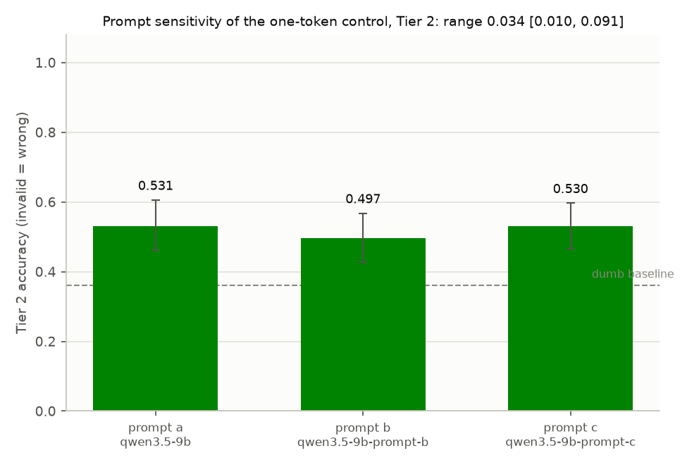
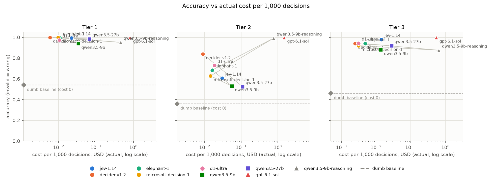
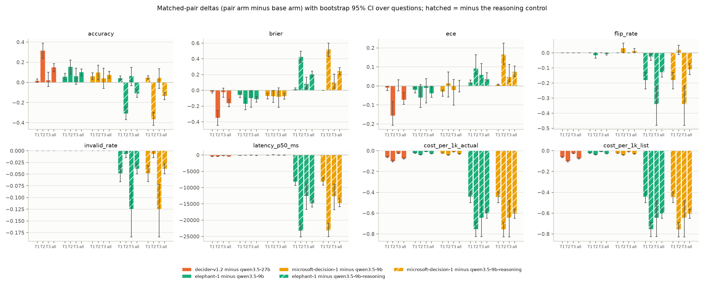
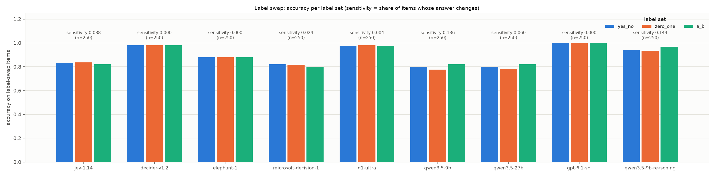
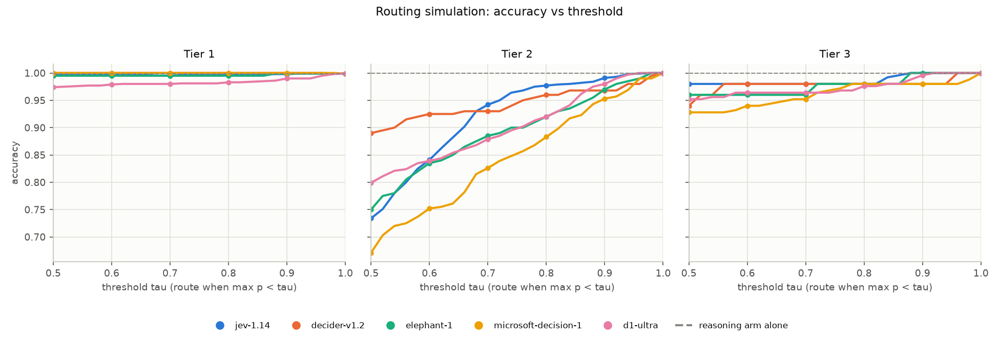
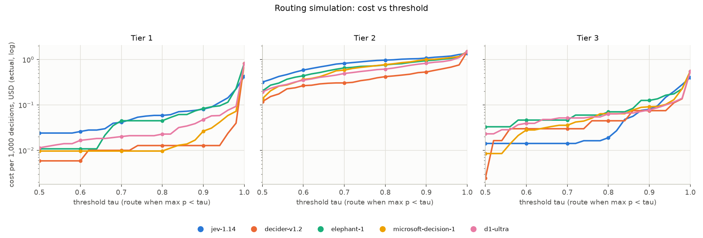

# Decision models vs LLMs - analysis report
Generated 2026-10-30 18:38 UTC. Run `main-01,followup-01` (22250 base calls over 450 questions, 5 run(s) per question expected; label-swap rows from run `main-01,followup-01`: 6750).

## Follow-up (HANDOFF-2.md): does the head recover reasoning, or just the format?
1. **Reasoning control.** On Tier 2, `qwen3.5-9b-reasoning` (qwen3.5-9b weights with thinking on, then one token) scores 0.992 at $0.7695 per 1,000 decisions and 23506 ms p50 (invalid rate 0.007), against the heads built on the same weights: elephant-1 0.685 (head minus reasoning base -0.307 [-0.371, -0.248]; $0.01609 per 1,000 and 261 ms p50); microsoft-decision-1 0.628 (head minus reasoning base -0.364 [-0.425, -0.298]; $0.01447 per 1,000 and 368 ms p50).
2. **Prompt sensitivity.** On Tier 2 the one-token control moves from 0.497 (prompt b, `qwen3.5-9b-prompt-b`) to 0.531 (prompt a, `qwen3.5-9b`) across the three system prompts: range 0.034 [0.010, 0.091] (max minus min accuracy, bootstrap 95% CI over questions).

Prompt sensitivity, Tier 2 (`prompt_sensitivity.csv`; CI = bootstrap 95% over questions, on accuracy for an arm and on max minus min for the `range` rows):

| scope | arm | prompt | n | accuracy | CI lo | CI hi | Brier | ECE | invalid | flip |
|---|---|---|---|---|---|---|---|---|---|---|
| all | qwen3.5-9b | a | 1000 | 0.531 | 0.462 | 0.606 | 0.596 | 0.153 | 0.000 | 0.015 |
| all | qwen3.5-9b-prompt-b | b | 1000 | 0.497 | 0.428 | 0.568 | 0.603 | 0.154 | 0.000 | 0.035 |
| all | qwen3.5-9b-prompt-c | c | 1000 | 0.530 | 0.465 | 0.597 | 0.610 | 0.142 | 0.000 | 0.020 |
| all | range | max-min | not available | 0.034 | 0.010 | 0.091 | not available | not available | not available | not available |
| yesno | qwen3.5-9b | a | 400 | 0.588 | 0.487 | 0.700 | 0.594 | 0.225 | 0.000 | 0.000 |
| yesno | qwen3.5-9b-prompt-b | b | 400 | 0.560 | 0.457 | 0.675 | 0.567 | 0.219 | 0.000 | 0.013 |
| yesno | qwen3.5-9b-prompt-c | c | 400 | 0.522 | 0.412 | 0.637 | 0.608 | 0.254 | 0.000 | 0.013 |
| yesno | range | max-min | not available | 0.065 | 0.018 | 0.142 | not available | not available | not available | not available |
| choice | qwen3.5-9b | a | 400 | 0.578 | 0.465 | 0.680 | 0.508 | 0.106 | 0.000 | 0.025 |
| choice | qwen3.5-9b-prompt-b | b | 400 | 0.557 | 0.447 | 0.663 | 0.519 | 0.102 | 0.000 | 0.025 |
| choice | qwen3.5-9b-prompt-c | c | 400 | 0.605 | 0.487 | 0.710 | 0.525 | 0.105 | 0.000 | 0.025 |
| choice | range | max-min | not available | 0.047 | 0.012 | 0.125 | not available | not available | not available | not available |
| score | qwen3.5-9b | a | 200 | 0.325 | 0.200 | 0.475 | 0.774 | 0.110 | 0.000 | 0.025 |
| score | qwen3.5-9b-prompt-b | b | 200 | 0.250 | 0.125 | 0.400 | 0.845 | 0.156 | 0.000 | 0.100 |
| score | qwen3.5-9b-prompt-c | c | 200 | 0.395 | 0.250 | 0.545 | 0.781 | 0.067 | 0.000 | 0.025 |
| score | range | max-min | not available | 0.145 | 0.025 | 0.290 | not available | not available | not available | not available |

Note on `labelswap_sensitivity.csv`: the `qwen3.5-9b-reasoning` row (0.144) counts a call that hit the 12,000-token cap under one label set and answered under another as a change, so it is inflated by cap-outs and is not compared with the other arms.

## 1. Does the 9B decision head beat raw Qwen3.5-9B?
Versus raw qwen3.5-9b over all tiers: elephant-1 beats it on accuracy, calibration (Brier), calibration (ECE): accuracy +0.100 [0.067, 0.133], Brier -0.113, ECE -0.039, flip rate -0.007, at -$0.02858 per 1,000 decisions (actual); microsoft-decision-1 beats it on accuracy, calibration (Brier): accuracy +0.074 [0.042, 0.109], Brier -0.074, ECE -0.001, flip rate +0.013, at -$0.03001 per 1,000 decisions (actual).

## 2. Accuracy vs cost

List-price version: [charts/accuracy_vs_cost_list.png](charts/accuracy_vs_cost_list.png)

## 3. Matched-pair deltas (pair arm minus base arm; bootstrap 95% CI over question ids, 1000 reps, seed 20261029)

| pair arm | base arm | tier | metric | pair | base | delta | 95% CI | questions |
|---|---|---|---|---|---|---|---|---|
| decider-v1.2 | qwen3.5-27b | 1 | accuracy | 1.000 | 0.985 | 0.015 | [0.000, 0.035] | 200 |
| decider-v1.2 | qwen3.5-27b | 1 | brier | 0.002 | 0.018 | -0.016 | [-0.034, -0.002] | 200 |
| decider-v1.2 | qwen3.5-27b | 1 | ece | 0.005 | 0.015 | -0.009 | [-0.025, -0.001] | 200 |
| decider-v1.2 | qwen3.5-27b | 1 | flip_rate | 0.000 | 0.000 | 0.000 | [0.000, 0.000] | 200 |
| decider-v1.2 | qwen3.5-27b | 1 | invalid_rate | 0.000 | 0.000 | 0.000 | [0.000, 0.000] | 200 |
| decider-v1.2 | qwen3.5-27b | 1 | latency_p50_ms | 346.929 | 767.293 | -420.365 | [-447.350, -401.472] | 200 |
| decider-v1.2 | qwen3.5-27b | 1 | cost_per_1k_actual | $0.005865 | $0.06667 | -$0.06080 | [-$0.06552, -$0.05648] | 200 |
| decider-v1.2 | qwen3.5-27b | 1 | cost_per_1k_list | $0.005865 | $0.06667 | -$0.06080 | [-$0.06552, -$0.05648] | 200 |
| decider-v1.2 | qwen3.5-27b | 2 | accuracy | 0.840 | 0.525 | 0.315 | [0.240, 0.390] | 200 |
| decider-v1.2 | qwen3.5-27b | 2 | brier | 0.231 | 0.580 | -0.348 | [-0.443, -0.257] | 200 |
| decider-v1.2 | qwen3.5-27b | 2 | ece | 0.061 | 0.217 | -0.156 | [-0.207, -0.083] | 200 |
| decider-v1.2 | qwen3.5-27b | 2 | flip_rate | 0.000 | 0.000 | 0.000 | [0.000, 0.000] | 200 |
| decider-v1.2 | qwen3.5-27b | 2 | invalid_rate | 0.000 | 0.000 | 0.000 | [0.000, 0.000] | 200 |
| decider-v1.2 | qwen3.5-27b | 2 | latency_p50_ms | 377.322 | 781.137 | -403.815 | [-434.388, -361.730] | 200 |
| decider-v1.2 | qwen3.5-27b | 2 | cost_per_1k_actual | $0.008899 | $0.1090 | -$0.1001 | [-$0.1069, -$0.09334] | 200 |
| decider-v1.2 | qwen3.5-27b | 2 | cost_per_1k_list | $0.008899 | $0.1090 | -$0.1001 | [-$0.1069, -$0.09334] | 200 |
| decider-v1.2 | qwen3.5-27b | 3 | accuracy | 0.940 | 0.920 | 0.020 | [-0.040, 0.100] | 50 |
| decider-v1.2 | qwen3.5-27b | 3 | brier | 0.064 | 0.086 | -0.022 | [-0.089, 0.027] | 50 |
| decider-v1.2 | qwen3.5-27b | 3 | ece | 0.045 | 0.044 | 0.001 | [-0.026, 0.032] | 50 |
| decider-v1.2 | qwen3.5-27b | 3 | flip_rate | 0.000 | 0.000 | 0.000 | [0.000, 0.000] | 50 |
| decider-v1.2 | qwen3.5-27b | 3 | invalid_rate | 0.000 | 0.000 | 0.000 | [0.000, 0.000] | 50 |
| decider-v1.2 | qwen3.5-27b | 3 | latency_p50_ms | 312.104 | 504.236 | -192.132 | [-214.559, -169.722] | 50 |
| decider-v1.2 | qwen3.5-27b | 3 | cost_per_1k_actual | $0.002464 | $0.02792 | -$0.02546 | [-$0.02699, -$0.02396] | 50 |
| decider-v1.2 | qwen3.5-27b | 3 | cost_per_1k_list | $0.002464 | $0.02792 | -$0.02546 | [-$0.02699, -$0.02396] | 50 |
| decider-v1.2 | qwen3.5-27b | all | accuracy | 0.922 | 0.773 | 0.149 | [0.107, 0.187] | 450 |
| decider-v1.2 | qwen3.5-27b | all | brier | 0.111 | 0.275 | -0.165 | [-0.209, -0.117] | 450 |
| decider-v1.2 | qwen3.5-27b | all | ece | 0.027 | 0.100 | -0.073 | [-0.097, -0.035] | 450 |
| decider-v1.2 | qwen3.5-27b | all | flip_rate | 0.000 | 0.000 | 0.000 | [0.000, 0.000] | 450 |
| decider-v1.2 | qwen3.5-27b | all | invalid_rate | 0.000 | 0.000 | 0.000 | [0.000, 0.000] | 450 |
| decider-v1.2 | qwen3.5-27b | all | latency_p50_ms | 355.403 | 742.748 | -387.345 | [-412.117, -364.455] | 450 |
| decider-v1.2 | qwen3.5-27b | all | cost_per_1k_actual | $0.006836 | $0.08116 | -$0.07432 | [-$0.07871, -$0.07012] | 450 |
| decider-v1.2 | qwen3.5-27b | all | cost_per_1k_list | $0.006836 | $0.08116 | -$0.07432 | [-$0.07871, -$0.07012] | 450 |
| elephant-1 | qwen3.5-9b | 1 | accuracy | 0.995 | 0.940 | 0.055 | [0.025, 0.090] | 200 |
| elephant-1 | qwen3.5-9b | 1 | brier | 0.014 | 0.072 | -0.059 | [-0.092, -0.029] | 200 |
| elephant-1 | qwen3.5-9b | 1 | ece | 0.018 | 0.037 | -0.020 | [-0.038, -0.008] | 200 |
| elephant-1 | qwen3.5-9b | 1 | flip_rate | 0.000 | 0.000 | 0.000 | [0.000, 0.000] | 200 |
| elephant-1 | qwen3.5-9b | 1 | invalid_rate | 0.000 | 0.000 | 0.000 | [0.000, 0.000] | 200 |
| elephant-1 | qwen3.5-9b | 1 | latency_p50_ms | 255.721 | 379.880 | -124.159 | [-147.571, -99.595] | 200 |
| elephant-1 | qwen3.5-9b | 1 | cost_per_1k_actual | $0.01080 | $0.03364 | -$0.02284 | [-$0.02482, -$0.02107] | 200 |
| elephant-1 | qwen3.5-9b | 1 | cost_per_1k_list | $0.01080 | $0.03364 | -$0.02284 | [-$0.02482, -$0.02107] | 200 |
| elephant-1 | qwen3.5-9b | 2 | accuracy | 0.685 | 0.531 | 0.154 | [0.085, 0.220] | 200 |
| elephant-1 | qwen3.5-9b | 2 | brier | 0.425 | 0.596 | -0.170 | [-0.245, -0.097] | 200 |
| elephant-1 | qwen3.5-9b | 2 | ece | 0.092 | 0.153 | -0.061 | [-0.114, 0.007] | 200 |
| elephant-1 | qwen3.5-9b | 2 | flip_rate | 0.000 | 0.015 | -0.015 | [-0.035, 0.000] | 200 |
| elephant-1 | qwen3.5-9b | 2 | invalid_rate | 0.000 | 0.000 | 0.000 | [0.000, 0.000] | 200 |
| elephant-1 | qwen3.5-9b | 2 | latency_p50_ms | 261.436 | 312.665 | -51.230 | [-67.011, -35.595] | 200 |
| elephant-1 | qwen3.5-9b | 2 | cost_per_1k_actual | $0.01609 | $0.05533 | -$0.03923 | [-$0.04208, -$0.03648] | 200 |
| elephant-1 | qwen3.5-9b | 2 | cost_per_1k_list | $0.01609 | $0.05533 | -$0.03923 | [-$0.04208, -$0.03648] | 200 |
| elephant-1 | qwen3.5-9b | 3 | accuracy | 0.940 | 0.880 | 0.060 | [-0.020, 0.140] | 50 |
| elephant-1 | qwen3.5-9b | 3 | brier | 0.084 | 0.184 | -0.100 | [-0.216, -0.005] | 50 |
| elephant-1 | qwen3.5-9b | 3 | ece | 0.057 | 0.067 | -0.010 | [-0.090, 0.039] | 50 |
| elephant-1 | qwen3.5-9b | 3 | flip_rate | 0.000 | 0.000 | 0.000 | [0.000, 0.000] | 50 |
| elephant-1 | qwen3.5-9b | 3 | invalid_rate | 0.000 | 0.000 | 0.000 | [0.000, 0.000] | 50 |
| elephant-1 | qwen3.5-9b | 3 | latency_p50_ms | 319.014 | 306.404 | 12.610 | [-21.499, 56.865] | 50 |
| elephant-1 | qwen3.5-9b | 3 | cost_per_1k_actual | $0.004808 | $0.01377 | -$0.008960 | [-$0.009551, -$0.008395] | 50 |
| elephant-1 | qwen3.5-9b | 3 | cost_per_1k_list | $0.004808 | $0.01377 | -$0.008960 | [-$0.009551, -$0.008395] | 50 |
| elephant-1 | qwen3.5-9b | all | accuracy | 0.851 | 0.752 | 0.100 | [0.067, 0.133] | 450 |
| elephant-1 | qwen3.5-9b | all | brier | 0.204 | 0.317 | -0.113 | [-0.149, -0.078] | 450 |
| elephant-1 | qwen3.5-9b | all | ece | 0.036 | 0.075 | -0.039 | [-0.060, -0.002] | 450 |
| elephant-1 | qwen3.5-9b | all | flip_rate | 0.000 | 0.007 | -0.007 | [-0.013, 0.000] | 450 |
| elephant-1 | qwen3.5-9b | all | invalid_rate | 0.000 | 0.000 | 0.000 | [0.000, 0.000] | 450 |
| elephant-1 | qwen3.5-9b | all | latency_p50_ms | 262.911 | 342.147 | -79.237 | [-93.351, -63.208] | 450 |
| elephant-1 | qwen3.5-9b | all | cost_per_1k_actual | $0.01249 | $0.04107 | -$0.02858 | [-$0.03041, -$0.02683] | 450 |
| elephant-1 | qwen3.5-9b | all | cost_per_1k_list | $0.01249 | $0.04107 | -$0.02858 | [-$0.03041, -$0.02683] | 450 |
| microsoft-decision-1 | qwen3.5-9b | 1 | accuracy | 1.000 | 0.940 | 0.060 | [0.030, 0.095] | 200 |
| microsoft-decision-1 | qwen3.5-9b | 1 | brier | 0.001 | 0.072 | -0.071 | [-0.109, -0.037] | 200 |
| microsoft-decision-1 | qwen3.5-9b | 1 | ece | 0.007 | 0.037 | -0.031 | [-0.054, -0.021] | 200 |
| microsoft-decision-1 | qwen3.5-9b | 1 | flip_rate | 0.000 | 0.000 | 0.000 | [0.000, 0.000] | 200 |
| microsoft-decision-1 | qwen3.5-9b | 1 | invalid_rate | 0.000 | 0.000 | 0.000 | [0.000, 0.000] | 200 |
| microsoft-decision-1 | qwen3.5-9b | 1 | latency_p50_ms | 326.604 | 379.880 | -53.276 | [-78.288, -24.618] | 200 |
| microsoft-decision-1 | qwen3.5-9b | 1 | cost_per_1k_actual | $0.009648 | $0.03364 | -$0.02399 | [-$0.02608, -$0.02214] | 200 |
| microsoft-decision-1 | qwen3.5-9b | 1 | cost_per_1k_list | $0.009648 | $0.03364 | -$0.02399 | [-$0.02608, -$0.02214] | 200 |
| microsoft-decision-1 | qwen3.5-9b | 2 | accuracy | 0.628 | 0.531 | 0.097 | [0.027, 0.169] | 200 |
| microsoft-decision-1 | qwen3.5-9b | 2 | brier | 0.521 | 0.596 | -0.075 | [-0.155, -0.004] | 200 |
| microsoft-decision-1 | qwen3.5-9b | 2 | ece | 0.166 | 0.153 | 0.013 | [-0.059, 0.073] | 200 |
| microsoft-decision-1 | qwen3.5-9b | 2 | flip_rate | 0.045 | 0.015 | 0.030 | [-0.000, 0.065] | 200 |
| microsoft-decision-1 | qwen3.5-9b | 2 | invalid_rate | 0.000 | 0.000 | 0.000 | [0.000, 0.000] | 200 |
| microsoft-decision-1 | qwen3.5-9b | 2 | latency_p50_ms | 367.895 | 312.665 | 55.230 | [34.125, 72.863] | 200 |
| microsoft-decision-1 | qwen3.5-9b | 2 | cost_per_1k_actual | $0.01447 | $0.05533 | -$0.04086 | [-$0.04385, -$0.03794] | 200 |
| microsoft-decision-1 | qwen3.5-9b | 2 | cost_per_1k_list | $0.01447 | $0.05533 | -$0.04086 | [-$0.04385, -$0.03794] | 200 |
| microsoft-decision-1 | qwen3.5-9b | 3 | accuracy | 0.920 | 0.880 | 0.040 | [-0.060, 0.140] | 50 |
| microsoft-decision-1 | qwen3.5-9b | 3 | brier | 0.101 | 0.184 | -0.082 | [-0.216, 0.032] | 50 |
| microsoft-decision-1 | qwen3.5-9b | 3 | ece | 0.046 | 0.067 | -0.021 | [-0.101, 0.034] | 50 |
| microsoft-decision-1 | qwen3.5-9b | 3 | flip_rate | 0.000 | 0.000 | 0.000 | [0.000, 0.000] | 50 |
| microsoft-decision-1 | qwen3.5-9b | 3 | invalid_rate | 0.000 | 0.000 | 0.000 | [0.000, 0.000] | 50 |
| microsoft-decision-1 | qwen3.5-9b | 3 | latency_p50_ms | 293.062 | 306.404 | -13.342 | [-45.118, 16.808] | 50 |
| microsoft-decision-1 | qwen3.5-9b | 3 | cost_per_1k_actual | $0.003105 | $0.01377 | -$0.01066 | [-$0.01137, -$0.01000] | 50 |
| microsoft-decision-1 | qwen3.5-9b | 3 | cost_per_1k_list | $0.003105 | $0.01377 | -$0.01066 | [-$0.01137, -$0.01000] | 50 |
| microsoft-decision-1 | qwen3.5-9b | all | accuracy | 0.826 | 0.752 | 0.074 | [0.042, 0.109] | 450 |
| microsoft-decision-1 | qwen3.5-9b | all | brier | 0.243 | 0.317 | -0.074 | [-0.112, -0.037] | 450 |
| microsoft-decision-1 | qwen3.5-9b | all | ece | 0.074 | 0.075 | -0.001 | [-0.032, 0.029] | 450 |
| microsoft-decision-1 | qwen3.5-9b | all | flip_rate | 0.020 | 0.007 | 0.013 | [-0.000, 0.029] | 450 |
| microsoft-decision-1 | qwen3.5-9b | all | invalid_rate | 0.000 | 0.000 | 0.000 | [0.000, 0.000] | 450 |
| microsoft-decision-1 | qwen3.5-9b | all | latency_p50_ms | 342.224 | 342.147 | 0.077 | [-16.428, 15.351] | 450 |
| microsoft-decision-1 | qwen3.5-9b | all | cost_per_1k_actual | $0.01106 | $0.04107 | -$0.03001 | [-$0.03190, -$0.02820] | 450 |
| microsoft-decision-1 | qwen3.5-9b | all | cost_per_1k_list | $0.01106 | $0.04107 | -$0.03001 | [-$0.03190, -$0.02820] | 450 |
| elephant-1 | qwen3.5-9b-reasoning | 1 | accuracy | 0.995 | 0.952 | 0.043 | [0.024, 0.062] | 200 |
| elephant-1 | qwen3.5-9b-reasoning | 1 | brier | 0.014 | 0.000 | 0.014 | [0.003, 0.032] | 200 |
| elephant-1 | qwen3.5-9b-reasoning | 1 | ece | 0.018 | 0.000 | 0.018 | [0.014, 0.031] | 200 |
| elephant-1 | qwen3.5-9b-reasoning | 1 | flip_rate | 0.000 | 0.180 | -0.180 | [-0.240, -0.130] | 200 |
| elephant-1 | qwen3.5-9b-reasoning | 1 | invalid_rate | 0.000 | 0.048 | -0.048 | [-0.066, -0.032] | 200 |
| elephant-1 | qwen3.5-9b-reasoning | 1 | latency_p50_ms | 255.721 | 8461.294 | -8205.573 | [-9346.866, -6975.120] | 200 |
| elephant-1 | qwen3.5-9b-reasoning | 1 | cost_per_1k_actual | $0.01080 | $0.4536 | -$0.4428 | [-$0.4999, -$0.3940] | 200 |
| elephant-1 | qwen3.5-9b-reasoning | 1 | cost_per_1k_list | $0.01080 | $0.4536 | -$0.4428 | [-$0.4999, -$0.3940] | 200 |
| elephant-1 | qwen3.5-9b-reasoning | 2 | accuracy | 0.685 | 0.992 | -0.307 | [-0.371, -0.248] | 200 |
| elephant-1 | qwen3.5-9b-reasoning | 2 | brier | 0.425 | 0.002 | 0.423 | [0.351, 0.497] | 200 |
| elephant-1 | qwen3.5-9b-reasoning | 2 | ece | 0.092 | 0.000 | 0.092 | [0.064, 0.163] | 200 |
| elephant-1 | qwen3.5-9b-reasoning | 2 | flip_rate | 0.000 | 0.025 | -0.025 | [-0.050, -0.005] | 200 |
| elephant-1 | qwen3.5-9b-reasoning | 2 | invalid_rate | 0.000 | 0.007 | -0.007 | [-0.015, -0.002] | 200 |
| elephant-1 | qwen3.5-9b-reasoning | 2 | latency_p50_ms | 261.436 | 23506.135 | -23244.699 | [-25191.271, -21140.606] | 200 |
| elephant-1 | qwen3.5-9b-reasoning | 2 | cost_per_1k_actual | $0.01609 | $0.7695 | -$0.7534 | [-$0.8265, -$0.6893] | 200 |
| elephant-1 | qwen3.5-9b-reasoning | 2 | cost_per_1k_list | $0.01609 | $0.7695 | -$0.7534 | [-$0.8265, -$0.6893] | 200 |
| elephant-1 | qwen3.5-9b-reasoning | 3 | accuracy | 0.940 | 0.876 | 0.064 | [-0.032, 0.148] | 50 |
| elephant-1 | qwen3.5-9b-reasoning | 3 | brier | 0.084 | 0.000 | 0.084 | [0.017, 0.168] | 50 |
| elephant-1 | qwen3.5-9b-reasoning | 3 | ece | 0.057 | 0.000 | 0.057 | [0.031, 0.117] | 50 |
| elephant-1 | qwen3.5-9b-reasoning | 3 | flip_rate | 0.000 | 0.340 | -0.340 | [-0.480, -0.220] | 50 |
| elephant-1 | qwen3.5-9b-reasoning | 3 | invalid_rate | 0.000 | 0.124 | -0.124 | [-0.184, -0.072] | 50 |
| elephant-1 | qwen3.5-9b-reasoning | 3 | latency_p50_ms | 319.014 | 12915.142 | -12596.128 | [-16739.539, -8914.296] | 50 |
| elephant-1 | qwen3.5-9b-reasoning | 3 | cost_per_1k_actual | $0.004808 | $0.6486 | -$0.6438 | [-$0.8261, -$0.4806] | 50 |
| elephant-1 | qwen3.5-9b-reasoning | 3 | cost_per_1k_list | $0.004808 | $0.6486 | -$0.6438 | [-$0.8261, -$0.4806] | 50 |
| elephant-1 | qwen3.5-9b-reasoning | all | accuracy | 0.851 | 0.961 | -0.110 | [-0.147, -0.076] | 450 |
| elephant-1 | qwen3.5-9b-reasoning | all | brier | 0.204 | 0.001 | 0.203 | [0.166, 0.243] | 450 |
| elephant-1 | qwen3.5-9b-reasoning | all | ece | 0.036 | 0.000 | 0.036 | [0.026, 0.069] | 450 |
| elephant-1 | qwen3.5-9b-reasoning | all | flip_rate | 0.000 | 0.129 | -0.129 | [-0.160, -0.098] | 450 |
| elephant-1 | qwen3.5-9b-reasoning | all | invalid_rate | 0.000 | 0.038 | -0.038 | [-0.049, -0.028] | 450 |
| elephant-1 | qwen3.5-9b-reasoning | all | latency_p50_ms | 262.911 | 15095.755 | -14832.845 | [-15965.482, -13468.854] | 450 |
| elephant-1 | qwen3.5-9b-reasoning | all | cost_per_1k_actual | $0.01249 | $0.6157 | -$0.6032 | [-$0.6496, -$0.5602] | 450 |
| elephant-1 | qwen3.5-9b-reasoning | all | cost_per_1k_list | $0.01249 | $0.6157 | -$0.6032 | [-$0.6496, -$0.5602] | 450 |
| microsoft-decision-1 | qwen3.5-9b-reasoning | 1 | accuracy | 1.000 | 0.952 | 0.048 | [0.032, 0.066] | 200 |
| microsoft-decision-1 | qwen3.5-9b-reasoning | 1 | brier | 0.001 | 0.000 | 0.001 | [0.000, 0.002] | 200 |
| microsoft-decision-1 | qwen3.5-9b-reasoning | 1 | ece | 0.007 | 0.000 | 0.007 | [0.004, 0.010] | 200 |
| microsoft-decision-1 | qwen3.5-9b-reasoning | 1 | flip_rate | 0.000 | 0.180 | -0.180 | [-0.240, -0.130] | 200 |
| microsoft-decision-1 | qwen3.5-9b-reasoning | 1 | invalid_rate | 0.000 | 0.048 | -0.048 | [-0.066, -0.032] | 200 |
| microsoft-decision-1 | qwen3.5-9b-reasoning | 1 | latency_p50_ms | 326.604 | 8461.294 | -8134.691 | [-9275.999, -6907.467] | 200 |
| microsoft-decision-1 | qwen3.5-9b-reasoning | 1 | cost_per_1k_actual | $0.009648 | $0.4536 | -$0.4439 | [-$0.5009, -$0.3952] | 200 |
| microsoft-decision-1 | qwen3.5-9b-reasoning | 1 | cost_per_1k_list | $0.009648 | $0.4536 | -$0.4439 | [-$0.5009, -$0.3952] | 200 |
| microsoft-decision-1 | qwen3.5-9b-reasoning | 2 | accuracy | 0.628 | 0.992 | -0.364 | [-0.425, -0.298] | 200 |
| microsoft-decision-1 | qwen3.5-9b-reasoning | 2 | brier | 0.521 | 0.002 | 0.519 | [0.433, 0.600] | 200 |
| microsoft-decision-1 | qwen3.5-9b-reasoning | 2 | ece | 0.166 | 0.000 | 0.166 | [0.114, 0.225] | 200 |
| microsoft-decision-1 | qwen3.5-9b-reasoning | 2 | flip_rate | 0.045 | 0.025 | 0.020 | [-0.010, 0.050] | 200 |
| microsoft-decision-1 | qwen3.5-9b-reasoning | 2 | invalid_rate | 0.000 | 0.007 | -0.007 | [-0.015, -0.002] | 200 |
| microsoft-decision-1 | qwen3.5-9b-reasoning | 2 | latency_p50_ms | 367.895 | 23506.135 | -23138.240 | [-25095.216, -21038.813] | 200 |
| microsoft-decision-1 | qwen3.5-9b-reasoning | 2 | cost_per_1k_actual | $0.01447 | $0.7695 | -$0.7551 | [-$0.8280, -$0.6909] | 200 |
| microsoft-decision-1 | qwen3.5-9b-reasoning | 2 | cost_per_1k_list | $0.01447 | $0.7695 | -$0.7551 | [-$0.8280, -$0.6909] | 200 |
| microsoft-decision-1 | qwen3.5-9b-reasoning | 3 | accuracy | 0.920 | 0.876 | 0.044 | [-0.060, 0.136] | 50 |
| microsoft-decision-1 | qwen3.5-9b-reasoning | 3 | brier | 0.101 | 0.000 | 0.101 | [0.023, 0.205] | 50 |
| microsoft-decision-1 | qwen3.5-9b-reasoning | 3 | ece | 0.046 | 0.000 | 0.046 | [0.022, 0.113] | 50 |
| microsoft-decision-1 | qwen3.5-9b-reasoning | 3 | flip_rate | 0.000 | 0.340 | -0.340 | [-0.480, -0.220] | 50 |
| microsoft-decision-1 | qwen3.5-9b-reasoning | 3 | invalid_rate | 0.000 | 0.124 | -0.124 | [-0.184, -0.072] | 50 |
| microsoft-decision-1 | qwen3.5-9b-reasoning | 3 | latency_p50_ms | 293.062 | 12915.142 | -12622.080 | [-16748.275, -8927.068] | 50 |
| microsoft-decision-1 | qwen3.5-9b-reasoning | 3 | cost_per_1k_actual | $0.003105 | $0.6486 | -$0.6455 | [-$0.8277, -$0.4823] | 50 |
| microsoft-decision-1 | qwen3.5-9b-reasoning | 3 | cost_per_1k_list | $0.003105 | $0.6486 | -$0.6455 | [-$0.8277, -$0.4823] | 50 |
| microsoft-decision-1 | qwen3.5-9b-reasoning | all | accuracy | 0.826 | 0.961 | -0.136 | [-0.173, -0.099] | 450 |
| microsoft-decision-1 | qwen3.5-9b-reasoning | all | brier | 0.243 | 0.001 | 0.242 | [0.198, 0.288] | 450 |
| microsoft-decision-1 | qwen3.5-9b-reasoning | all | ece | 0.074 | 0.000 | 0.074 | [0.049, 0.105] | 450 |
| microsoft-decision-1 | qwen3.5-9b-reasoning | all | flip_rate | 0.020 | 0.129 | -0.109 | [-0.144, -0.073] | 450 |
| microsoft-decision-1 | qwen3.5-9b-reasoning | all | invalid_rate | 0.000 | 0.038 | -0.038 | [-0.049, -0.028] | 450 |
| microsoft-decision-1 | qwen3.5-9b-reasoning | all | latency_p50_ms | 342.224 | 15095.755 | -14753.531 | [-15881.673, -13393.088] | 450 |
| microsoft-decision-1 | qwen3.5-9b-reasoning | all | cost_per_1k_actual | $0.01106 | $0.6157 | -$0.6046 | [-$0.6511, -$0.5617] | 450 |
| microsoft-decision-1 | qwen3.5-9b-reasoning | all | cost_per_1k_list | $0.01106 | $0.6157 | -$0.6046 | [-$0.6511, -$0.5617] | 450 |

## 4. Metrics per tier

### Tier 1
| arm | n | accuracy | macro-F1 | Brier | ECE | flip | invalid | missing | p50 ms | p95 ms | cost/1k actual | cost/1k list | probs |
|---|---|---|---|---|---|---|---|---|---|---|---|---|---|
| jev-1.14 | 1000 | 0.995 | 0.995 | 0.012 | 0.018 | 0.010 | 0.000 | 0.000 | 281 | 537 | $0.02207 | $0.02207 | decision |
| decider-v1.2 | 1000 | 1.000 | 1.000 | 0.002 | 0.005 | 0.000 | 0.000 | 0.000 | 347 | 718 | $0.005865 | $0.005865 | decision |
| elephant-1 | 1000 | 0.995 | 0.997 | 0.014 | 0.018 | 0.000 | 0.000 | 0.000 | 256 | 550 | $0.01080 | $0.01080 | decision |
| microsoft-decision-1 | 1000 | 1.000 | 1.000 | 0.001 | 0.007 | 0.000 | 0.000 | 0.000 | 327 | 656 | $0.009648 | $0.009648 | decision |
| d1-ultra | 1000 | 0.974 | 0.978 | 0.039 | 0.016 | 0.015 | 0.000 | 0.000 | 334 | 642 | $0.01049 | $0.01049 | decision |
| qwen3.5-9b | 1000 | 0.940 | 0.947 | 0.072 | 0.037 | 0.000 | 0.000 | 0.000 | 380 | 1835 | $0.03364 | $0.03364 | logprobs |
| qwen3.5-27b | 1000 | 0.985 | 0.985 | 0.018 | 0.015 | 0.000 | 0.000 | 0.000 | 767 | 1683 | $0.06667 | $0.06667 | logprobs |
| gpt-6.1-sol | 1000 | 0.999 | 0.999 | 0.002 | 0.002 | 0.005 | 0.000 | 0.000 | 1653 | 2542 | $0.8149 | $0.8149 | verbalized |
| qwen3.5-9b-reasoning | 1000 | 0.952 | 0.986 | 0.000 | 0.000 | 0.180 | 0.048 | 0.000 | 8461 | 38554 | $0.4536 | $0.4536 | verbalized |
| baseline | 200 | 0.540 | 0.382 | not available | not available | not available | 0.000 | 0.000 | not available | not available | $0 | $0 | none |

### Tier 2
| arm | n | accuracy | macro-F1 | Brier | ECE | flip | invalid | missing | p50 ms | p95 ms | cost/1k actual | cost/1k list | probs |
|---|---|---|---|---|---|---|---|---|---|---|---|---|---|
| jev-1.14 | 1000 | 0.606 | 0.584 | 0.425 | 0.115 | 0.125 | 0.000 | 0.000 | 282 | 583 | $0.03004 | $0.03004 | decision |
| decider-v1.2 | 1000 | 0.840 | 0.807 | 0.231 | 0.061 | 0.000 | 0.000 | 0.000 | 377 | 914 | $0.008899 | $0.008899 | decision |
| elephant-1 | 1000 | 0.685 | 0.670 | 0.425 | 0.092 | 0.000 | 0.000 | 0.000 | 261 | 576 | $0.01609 | $0.01609 | decision |
| microsoft-decision-1 | 1000 | 0.628 | 0.607 | 0.521 | 0.166 | 0.045 | 0.000 | 0.000 | 368 | 767 | $0.01447 | $0.01447 | decision |
| d1-ultra | 1000 | 0.729 | 0.687 | 0.375 | 0.096 | 0.135 | 0.000 | 0.000 | 364 | 881 | $0.01845 | $0.01845 | decision |
| qwen3.5-9b | 1000 | 0.531 | 0.494 | 0.596 | 0.153 | 0.015 | 0.000 | 0.000 | 313 | 2175 | $0.05533 | $0.05533 | logprobs |
| qwen3.5-27b | 1000 | 0.525 | 0.481 | 0.580 | 0.217 | 0.000 | 0.000 | 0.000 | 781 | 7856 | $0.1090 | $0.1090 | logprobs |
| gpt-6.1-sol | 1000 | 1.000 | 1.000 | 0.000 | 0.000 | 0.000 | 0.000 | 0.000 | 2368 | 4086 | $1.491 | $1.491 | verbalized |
| qwen3.5-9b-reasoning | 1000 | 0.992 | 0.988 | 0.002 | 0.000 | 0.025 | 0.007 | 0.000 | 23506 | 76065 | $0.7695 | $0.7695 | verbalized |
| qwen3.5-9b-prompt-b | 1000 | 0.497 | 0.454 | 0.603 | 0.154 | 0.035 | 0.000 | 0.000 | 278 | 437 | $0.05243 | $0.05243 | logprobs |
| qwen3.5-9b-prompt-c | 1000 | 0.530 | 0.509 | 0.610 | 0.142 | 0.020 | 0.000 | 0.000 | 284 | 450 | $0.05573 | $0.05573 | logprobs |
| baseline | 200 | 0.360 | 0.170 | not available | not available | not available | 0.000 | 0.000 | not available | not available | $0 | $0 | none |

### Tier 3
| arm | n | accuracy | macro-F1 | Brier | ECE | flip | invalid | missing | p50 ms | p95 ms | cost/1k actual | cost/1k list | probs |
|---|---|---|---|---|---|---|---|---|---|---|---|---|---|
| jev-1.14 | 250 | 0.980 | 0.977 | 0.035 | 0.029 | 0.000 | 0.000 | 0.000 | 400 | 1054 | $0.01418 | $0.01418 | decision |
| decider-v1.2 | 250 | 0.940 | 0.932 | 0.064 | 0.045 | 0.000 | 0.000 | 0.000 | 312 | 651 | $0.002464 | $0.002464 | decision |
| elephant-1 | 250 | 0.940 | 0.882 | 0.084 | 0.057 | 0.000 | 0.000 | 0.000 | 319 | 807 | $0.004808 | $0.004808 | decision |
| microsoft-decision-1 | 250 | 0.920 | 0.888 | 0.101 | 0.046 | 0.000 | 0.000 | 0.000 | 293 | 510 | $0.003105 | $0.003105 | decision |
| d1-ultra | 250 | 0.944 | 0.942 | 0.084 | 0.045 | 0.040 | 0.000 | 0.000 | 293 | 513 | $0.003146 | $0.003146 | decision |
| qwen3.5-9b | 250 | 0.880 | 0.759 | 0.184 | 0.067 | 0.000 | 0.000 | 0.000 | 306 | 1486 | $0.01377 | $0.01377 | logprobs |
| qwen3.5-27b | 250 | 0.920 | 0.903 | 0.086 | 0.044 | 0.000 | 0.000 | 0.000 | 504 | 682 | $0.02792 | $0.02792 | logprobs |
| gpt-6.1-sol | 250 | 1.000 | 1.000 | 0.000 | 0.000 | 0.000 | 0.000 | 0.000 | 1772 | 2762 | $0.5476 | $0.5476 | verbalized |
| qwen3.5-9b-reasoning | 250 | 0.876 | 0.950 | 0.000 | 0.000 | 0.340 | 0.124 | 0.000 | 12915 | 159406 | $0.6486 | $0.6486 | verbalized |
| baseline | 50 | 0.460 | 0.260 | not available | not available | not available | 0.000 | 0.000 | not available | not available | $0 | $0 | none |

Reliability diagrams: [reliability.png](charts/reliability.png)

### Dumb baseline (no API)
| tier | format | n | accuracy | macro-F1 | rule |
|---|---|---|---|---|---|
| 1 | all | 200 | 0.540 | 0.382 | keyword-regex |
| 1 | choice | 80 | 0.400 | 0.277 | keyword-regex |
| 1 | score | 40 | 0.550 | 0.571 | keyword-regex |
| 1 | yesno | 80 | 0.675 | 0.630 | keyword-regex |
| 2 | all | 200 | 0.360 | 0.170 | majority-class |
| 2 | choice | 80 | 0.237 | 0.064 | majority-class |
| 2 | score | 40 | 0.275 | 0.086 | majority-class |
| 2 | yesno | 80 | 0.525 | 0.344 | majority-class |
| 3 | all | 50 | 0.460 | 0.260 | majority-class |
| 3 | choice | 20 | 0.450 | 0.207 | majority-class |
| 3 | score | 10 | 0.400 | 0.143 | majority-class |
| 3 | yesno | 20 | 0.500 | 0.333 | majority-class |

Tier 1: the dumb baseline scores 0.540 vs jev-1.14 0.995 (gap +0.455); the baseline is not within 5 points of jev-1.14.

## 5. Metrics per format

### yesno
| arm | n | accuracy | macro-F1 | Brier | ECE | flip | invalid | missing | p50 ms | p95 ms | cost/1k actual | cost/1k list | probs |
|---|---|---|---|---|---|---|---|---|---|---|---|---|---|
| jev-1.14 | 900 | 0.854 | 0.854 | 0.163 | 0.056 | 0.039 | 0.000 | 0.000 | 285 | 595 | $0.02408 | $0.02408 | decision |
| decider-v1.2 | 900 | 0.972 | 0.972 | 0.046 | 0.025 | 0.000 | 0.000 | 0.000 | 353 | 715 | $0.006617 | $0.006617 | decision |
| elephant-1 | 900 | 0.883 | 0.883 | 0.177 | 0.066 | 0.000 | 0.000 | 0.000 | 259 | 586 | $0.01190 | $0.01190 | decision |
| microsoft-decision-1 | 900 | 0.861 | 0.861 | 0.208 | 0.069 | 0.022 | 0.000 | 0.000 | 338 | 661 | $0.01082 | $0.01082 | decision |
| d1-ultra | 900 | 0.951 | 0.951 | 0.073 | 0.013 | 0.044 | 0.000 | 0.000 | 329 | 659 | $0.01273 | $0.01273 | decision |
| qwen3.5-9b | 900 | 0.811 | 0.810 | 0.276 | 0.091 | 0.000 | 0.000 | 0.000 | 395 | 1748 | $0.03806 | $0.03806 | logprobs |
| qwen3.5-27b | 900 | 0.833 | 0.832 | 0.229 | 0.091 | 0.000 | 0.000 | 0.000 | 741 | 1930 | $0.07528 | $0.07528 | logprobs |
| gpt-6.1-sol | 900 | 0.999 | 0.999 | 0.002 | 0.002 | 0.006 | 0.000 | 0.000 | 1981 | 3551 | $1.002 | $1.002 | verbalized |
| qwen3.5-9b-reasoning | 900 | 0.932 | 0.965 | 0.002 | 0.001 | 0.211 | 0.067 | 0.000 | 18683 | 100385 | $0.7097 | $0.7097 | verbalized |
| qwen3.5-9b-prompt-b | 400 | 0.560 | 0.551 | 0.567 | 0.219 | 0.013 | 0.000 | 0.000 | 280 | 465 | $0.05164 | $0.05164 | logprobs |
| qwen3.5-9b-prompt-c | 400 | 0.522 | 0.512 | 0.608 | 0.254 | 0.013 | 0.000 | 0.000 | 282 | 491 | $0.05494 | $0.05494 | logprobs |
| baseline | 180 | 0.589 | 0.537 | not available | not available | not available | 0.000 | 0.000 | not available | not available | $0 | $0 | none |

### choice
| arm | n | accuracy | macro-F1 | Brier | ECE | flip | invalid | missing | p50 ms | p95 ms | cost/1k actual | cost/1k list | probs |
|---|---|---|---|---|---|---|---|---|---|---|---|---|---|
| jev-1.14 | 900 | 0.852 | 0.856 | 0.159 | 0.040 | 0.050 | 0.000 | 0.000 | 288 | 752 | $0.02468 | $0.02468 | decision |
| decider-v1.2 | 900 | 0.911 | 0.931 | 0.116 | 0.046 | 0.000 | 0.000 | 0.000 | 375 | 887 | $0.006788 | $0.006788 | decision |
| elephant-1 | 900 | 0.878 | 0.908 | 0.152 | 0.045 | 0.000 | 0.000 | 0.000 | 266 | 569 | $0.01229 | $0.01229 | decision |
| microsoft-decision-1 | 900 | 0.852 | 0.893 | 0.203 | 0.067 | 0.017 | 0.000 | 0.000 | 335 | 611 | $0.01113 | $0.01113 | decision |
| d1-ultra | 900 | 0.892 | 0.916 | 0.131 | 0.031 | 0.078 | 0.000 | 0.000 | 354 | 740 | $0.01300 | $0.01300 | decision |
| qwen3.5-9b | 900 | 0.807 | 0.855 | 0.235 | 0.047 | 0.011 | 0.000 | 0.000 | 310 | 2357 | $0.04126 | $0.04126 | logprobs |
| qwen3.5-27b | 900 | 0.811 | 0.856 | 0.226 | 0.079 | 0.000 | 0.000 | 0.000 | 738 | 1772 | $0.08152 | $0.08152 | logprobs |
| gpt-6.1-sol | 900 | 1.000 | 1.000 | 0.000 | 0.000 | 0.000 | 0.000 | 0.000 | 1838 | 4121 | $1.090 | $1.090 | verbalized |
| qwen3.5-9b-reasoning | 900 | 0.978 | 0.991 | 0.000 | 0.000 | 0.089 | 0.022 | 0.000 | 12049 | 37554 | $0.4507 | $0.4507 | verbalized |
| qwen3.5-9b-prompt-b | 400 | 0.557 | 0.515 | 0.519 | 0.102 | 0.025 | 0.000 | 0.000 | 273 | 415 | $0.04938 | $0.04938 | logprobs |
| qwen3.5-9b-prompt-c | 400 | 0.605 | 0.574 | 0.525 | 0.105 | 0.025 | 0.000 | 0.000 | 283 | 408 | $0.05268 | $0.05268 | logprobs |
| baseline | 180 | 0.333 | 0.215 | not available | not available | not available | 0.000 | 0.000 | not available | not available | $0 | $0 | none |

### score
| arm | n | accuracy | macro-F1 | Brier | ECE | flip | invalid | missing | p50 ms | p95 ms | cost/1k actual | cost/1k list | probs |
|---|---|---|---|---|---|---|---|---|---|---|---|---|---|
| jev-1.14 | 450 | 0.689 | 0.692 | 0.346 | 0.112 | 0.122 | 0.000 | 0.000 | 296 | 631 | $0.02615 | $0.02615 | decision |
| decider-v1.2 | 450 | 0.844 | 0.841 | 0.230 | 0.087 | 0.000 | 0.000 | 0.000 | 329 | 716 | $0.007368 | $0.007368 | decision |
| elephant-1 | 450 | 0.733 | 0.728 | 0.364 | 0.081 | 0.000 | 0.000 | 0.000 | 268 | 642 | $0.01405 | $0.01405 | decision |
| microsoft-decision-1 | 450 | 0.702 | 0.700 | 0.393 | 0.118 | 0.022 | 0.000 | 0.000 | 364 | 939 | $0.01140 | $0.01140 | decision |
| d1-ultra | 450 | 0.622 | 0.602 | 0.560 | 0.197 | 0.111 | 0.000 | 0.000 | 346 | 761 | $0.01460 | $0.01460 | decision |
| qwen3.5-9b | 450 | 0.522 | 0.505 | 0.566 | 0.112 | 0.011 | 0.000 | 0.000 | 284 | 1907 | $0.04672 | $0.04672 | logprobs |
| qwen3.5-27b | 450 | 0.578 | 0.593 | 0.466 | 0.159 | 0.000 | 0.000 | 0.000 | 762 | 9313 | $0.09217 | $0.09217 | logprobs |
| gpt-6.1-sol | 450 | 1.000 | 1.000 | 0.000 | 0.000 | 0.000 | 0.000 | 0.000 | 1846 | 3220 | $1.244 | $1.244 | verbalized |
| qwen3.5-9b-reasoning | 450 | 0.987 | 0.993 | 0.000 | 0.001 | 0.044 | 0.013 | 0.000 | 13882 | 80757 | $0.7577 | $0.7577 | verbalized |
| qwen3.5-9b-prompt-b | 200 | 0.250 | 0.146 | 0.845 | 0.156 | 0.100 | 0.000 | 0.000 | 290 | 412 | $0.06010 | $0.06010 | logprobs |
| qwen3.5-9b-prompt-c | 200 | 0.395 | 0.279 | 0.781 | 0.067 | 0.025 | 0.000 | 0.000 | 290 | 401 | $0.06340 | $0.06340 | logprobs |
| baseline | 90 | 0.411 | 0.393 | not available | not available | not available | 0.000 | 0.000 | not available | not available | $0 | $0 | none |

## 6. Label-swap sensitivity (yesno items rendered with yes/no, 1/0, A/B)
| arm | sensitivity | items (question x run) with all 3 sets | mean |dP(yes)| between sets |
|---|---|---|---|
| jev-1.14 | 0.088 | 250 | 0.030 |
| decider-v1.2 | 0.000 | 250 | 0.004 |
| elephant-1 | 0.000 | 250 | 0.010 |
| microsoft-decision-1 | 0.024 | 250 | 0.019 |
| d1-ultra | 0.004 | 250 | 0.014 |
| qwen3.5-9b | 0.136 | 250 | 0.102 |
| qwen3.5-27b | 0.060 | 250 | 0.024 |
| gpt-6.1-sol | 0.000 | 250 | 0.000 |
| qwen3.5-9b-reasoning | 0.144 | 250 | 0.000 |

| arm | label set | n | accuracy | AUC of P(yes) | n with probs |
|---|---|---|---|---|---|
| jev-1.14 | yes_no | 250 | 0.832 | 0.945 | 250 |
| jev-1.14 | zero_one | 250 | 0.836 | 0.948 | 250 |
| jev-1.14 | a_b | 250 | 0.820 | 0.940 | 250 |
| decider-v1.2 | yes_no | 250 | 0.980 | 0.995 | 250 |
| decider-v1.2 | zero_one | 250 | 0.980 | 0.994 | 250 |
| decider-v1.2 | a_b | 250 | 0.980 | 0.992 | 250 |
| elephant-1 | yes_no | 250 | 0.880 | 0.957 | 250 |
| elephant-1 | zero_one | 250 | 0.880 | 0.957 | 250 |
| elephant-1 | a_b | 250 | 0.880 | 0.956 | 250 |
| microsoft-decision-1 | yes_no | 250 | 0.820 | 0.924 | 250 |
| microsoft-decision-1 | zero_one | 250 | 0.816 | 0.921 | 250 |
| microsoft-decision-1 | a_b | 250 | 0.800 | 0.919 | 250 |
| d1-ultra | yes_no | 250 | 0.976 | 0.997 | 250 |
| d1-ultra | zero_one | 250 | 0.980 | 0.997 | 250 |
| d1-ultra | a_b | 250 | 0.976 | 0.999 | 250 |
| qwen3.5-9b | yes_no | 250 | 0.800 | 0.881 | 250 |
| qwen3.5-9b | zero_one | 250 | 0.776 | 0.895 | 250 |
| qwen3.5-9b | a_b | 250 | 0.820 | 0.901 | 250 |
| qwen3.5-27b | yes_no | 250 | 0.800 | 0.919 | 250 |
| qwen3.5-27b | zero_one | 250 | 0.780 | 0.913 | 250 |
| qwen3.5-27b | a_b | 250 | 0.820 | 0.911 | 250 |
| gpt-6.1-sol | yes_no | 250 | 1.000 | 1.000 | 250 |
| gpt-6.1-sol | zero_one | 250 | 1.000 | 1.000 | 250 |
| gpt-6.1-sol | a_b | 250 | 1.000 | 1.000 | 250 |
| qwen3.5-9b-reasoning | yes_no | 250 | 0.940 | 1.000 | 235 |
| qwen3.5-9b-reasoning | zero_one | 250 | 0.936 | 1.000 | 234 |
| qwen3.5-9b-reasoning | a_b | 250 | 0.968 | 1.000 | 242 |

## 7. Routing simulation (decision arm answers when max p >= tau, else the reasoning arm)
Reasoning arm: `gpt-6.1-sol`. Full grid in routing.csv; selected thresholds:

| arm | tier | tau | routed | accuracy | cost/1k |
|---|---|---|---|---|---|
| jev-1.14 | 1 | 0.60 | 0.002 | 0.996 | $0.02602 |
| jev-1.14 | 1 | 0.80 | 0.021 | 0.996 | $0.05880 |
| jev-1.14 | 1 | 0.90 | 0.037 | 0.998 | $0.08070 |
| jev-1.14 | 1 | 0.96 | 0.124 | 0.999 | $0.1434 |
| jev-1.14 | 1 | 1.00 | 0.492 | 0.999 | $0.4229 |
| jev-1.14 | 2 | 0.60 | 0.345 | 0.841 | $0.5859 |
| jev-1.14 | 2 | 0.80 | 0.599 | 0.977 | $0.9710 |
| jev-1.14 | 2 | 0.90 | 0.671 | 0.991 | $1.079 |
| jev-1.14 | 2 | 0.96 | 0.763 | 0.999 | $1.193 |
| jev-1.14 | 2 | 1.00 | 0.889 | 1.000 | $1.363 |
| jev-1.14 | 3 | 0.60 | 0.000 | 0.980 | $0.01418 |
| jev-1.14 | 3 | 0.80 | 0.008 | 0.980 | $0.01901 |
| jev-1.14 | 3 | 0.90 | 0.100 | 1.000 | $0.07998 |
| jev-1.14 | 3 | 0.96 | 0.300 | 1.000 | $0.1984 |
| jev-1.14 | 3 | 1.00 | 0.668 | 1.000 | $0.4031 |
| decider-v1.2 | 1 | 0.60 | 0.000 | 1.000 | $0.005865 |
| decider-v1.2 | 1 | 0.80 | 0.010 | 1.000 | $0.01276 |
| decider-v1.2 | 1 | 0.90 | 0.010 | 1.000 | $0.01276 |
| decider-v1.2 | 1 | 0.96 | 0.020 | 1.000 | $0.02368 |
| decider-v1.2 | 1 | 1.00 | 1.000 | 0.999 | $0.8207 |
| decider-v1.2 | 2 | 0.60 | 0.150 | 0.925 | $0.2662 |
| decider-v1.2 | 2 | 0.80 | 0.255 | 0.960 | $0.4201 |
| decider-v1.2 | 2 | 0.90 | 0.323 | 0.968 | $0.5316 |
| decider-v1.2 | 2 | 0.96 | 0.415 | 0.980 | $0.6793 |
| decider-v1.2 | 2 | 1.00 | 1.000 | 1.000 | $1.500 |
| decider-v1.2 | 3 | 0.60 | 0.040 | 0.980 | $0.02990 |
| decider-v1.2 | 3 | 0.80 | 0.060 | 0.980 | $0.04478 |
| decider-v1.2 | 3 | 0.90 | 0.100 | 0.980 | $0.07486 |
| decider-v1.2 | 3 | 0.96 | 0.160 | 1.000 | $0.1114 |
| decider-v1.2 | 3 | 1.00 | 1.000 | 1.000 | $0.5501 |
| elephant-1 | 1 | 0.60 | 0.000 | 0.995 | $0.01080 |
| elephant-1 | 1 | 0.80 | 0.020 | 0.995 | $0.04489 |
| elephant-1 | 1 | 0.90 | 0.055 | 0.999 | $0.08349 |
| elephant-1 | 1 | 0.96 | 0.095 | 0.999 | $0.1149 |
| elephant-1 | 1 | 1.00 | 1.000 | 0.999 | $0.8257 |
| elephant-1 | 2 | 0.60 | 0.260 | 0.835 | $0.4388 |
| elephant-1 | 2 | 0.80 | 0.465 | 0.920 | $0.7629 |
| elephant-1 | 2 | 0.90 | 0.590 | 0.970 | $0.9417 |
| elephant-1 | 2 | 0.96 | 0.670 | 0.990 | $1.054 |
| elephant-1 | 2 | 1.00 | 1.000 | 1.000 | $1.508 |
| elephant-1 | 3 | 0.60 | 0.060 | 0.960 | $0.04641 |
| elephant-1 | 3 | 0.80 | 0.100 | 0.980 | $0.07053 |
| elephant-1 | 3 | 0.90 | 0.180 | 1.000 | $0.1257 |
| elephant-1 | 3 | 0.96 | 0.260 | 1.000 | $0.1753 |
| elephant-1 | 3 | 1.00 | 1.000 | 1.000 | $0.5524 |
| microsoft-decision-1 | 1 | 0.60 | 0.000 | 1.000 | $0.009648 |
| microsoft-decision-1 | 1 | 0.80 | 0.000 | 1.000 | $0.009648 |
| microsoft-decision-1 | 1 | 0.90 | 0.022 | 1.000 | $0.02645 |
| microsoft-decision-1 | 1 | 0.96 | 0.060 | 1.000 | $0.05849 |
| microsoft-decision-1 | 1 | 1.00 | 1.000 | 0.999 | $0.8245 |
| microsoft-decision-1 | 2 | 0.60 | 0.210 | 0.752 | $0.3644 |
| microsoft-decision-1 | 2 | 0.80 | 0.470 | 0.883 | $0.7714 |
| microsoft-decision-1 | 2 | 0.90 | 0.624 | 0.953 | $0.9989 |
| microsoft-decision-1 | 2 | 0.96 | 0.699 | 0.990 | $1.107 |
| microsoft-decision-1 | 2 | 1.00 | 1.000 | 1.000 | $1.506 |
| microsoft-decision-1 | 3 | 0.60 | 0.040 | 0.940 | $0.02811 |
| microsoft-decision-1 | 3 | 0.80 | 0.100 | 0.980 | $0.06399 |
| microsoft-decision-1 | 3 | 0.90 | 0.140 | 0.980 | $0.09111 |
| microsoft-decision-1 | 3 | 0.96 | 0.204 | 0.980 | $0.1306 |
| microsoft-decision-1 | 3 | 1.00 | 1.000 | 1.000 | $0.5507 |
| d1-ultra | 1 | 0.60 | 0.007 | 0.979 | $0.01660 |
| d1-ultra | 1 | 0.80 | 0.014 | 0.983 | $0.02282 |
| d1-ultra | 1 | 0.90 | 0.037 | 0.990 | $0.04765 |
| d1-ultra | 1 | 0.96 | 0.059 | 0.995 | $0.07645 |
| d1-ultra | 1 | 1.00 | 1.000 | 0.999 | $0.8254 |
| d1-ultra | 2 | 0.60 | 0.200 | 0.839 | $0.3510 |
| d1-ultra | 2 | 0.80 | 0.365 | 0.920 | $0.6164 |
| d1-ultra | 2 | 0.90 | 0.507 | 0.980 | $0.8274 |
| d1-ultra | 2 | 0.96 | 0.608 | 1.000 | $0.9633 |
| d1-ultra | 2 | 1.00 | 1.000 | 1.000 | $1.510 |
| d1-ultra | 3 | 0.60 | 0.052 | 0.964 | $0.03935 |
| d1-ultra | 3 | 0.80 | 0.084 | 0.976 | $0.06351 |
| d1-ultra | 3 | 0.90 | 0.104 | 0.996 | $0.07771 |
| d1-ultra | 3 | 0.96 | 0.160 | 1.000 | $0.1158 |
| d1-ultra | 3 | 1.00 | 1.000 | 1.000 | $0.5507 |

## 8. Caveats
- Tier 3 ground truth is the agreement of two frontier models (generator and an independent checker), which is weak evidence compared with the machine-verified Tier 1 and Tier 2 answers.
- Reasoning-arm calibration uses a verbalized 0-100 confidence, not logprobs; its Brier/ECE are not directly comparable with the logprob/decision probabilities of the other arms (reasoning arms: gpt-6.1-sol, qwen3.5-9b-reasoning).
- Tier 3 questions were generated by anthropic/claude-fable-5.1 and cross-checked by openai/gpt-6-astra. Arms from the same vendors (gpt-6.1-sol) share those models' beliefs, so their Tier 3 scores are partly circular and should not be read as independent evidence.
- Brier is the multi-class form sum_k (p_k - y_k)^2 averaged over items; for yesno questions this equals twice the binary Brier score.
- Provider/region per arm (gen_provider, falling back to the response provider): jev-1.14: TypeSafe (3000); decider-v1.2: Perplexity (3000); elephant-1: BaseTen (3000); microsoft-decision-1: Azure (3000); d1-ultra: Liquid (3000); qwen3.5-9b: Parasail (3000); qwen3.5-27b: Alibaba (3000); gpt-6.1-sol: OpenAI (3000); qwen3.5-9b-reasoning: Parasail (3000); qwen3.5-9b-prompt-b: Parasail (1000); qwen3.5-9b-prompt-c: Parasail (1000).
- Arms with failed or missing calls (triples without an ok/invalid row count as missing): qwen3.5-9b (failed rows 30, worst missing rate 0.000); qwen3.5-9b-reasoning (failed rows 8, worst missing rate 0.000).
- No arm has prob_source 'none'.
- Expected call counts use the questions seen in this run (any arm) within each arm's config `scope` times the runs per question (5); accuracy pools all runs, so n = questions x runs.
- qwen3.5-9b-reasoning is the follow-up reasoning control (HANDOFF-2.md): the same weights and provider as qwen3.5-9b with thinking on and a 12,000-token completion cap; 86 of 2250 base calls produced no ANSWER line within the cap and count as invalid (= wrong). Its calibration is verbalized like the other reasoning arm's; the answer token's logprobs are recorded in parse_extra only.
- Prompt-variant arms (qwen3.5-9b-prompt-b, qwen3.5-9b-prompt-c) are the one-token control with a different system prompt, run on Tier 2 only without the label-swap subset; they appear in the per-tier/per-format tables and prompt_sensitivity.csv and are left out of the accuracy-vs-cost and reliability charts.
- Charts: the categorical palette holds 8 fixed arm colors; further arms are drawn in grays and every point is labelled by name, with marker shape by arm kind (circle = decision, square = instant, triangle = reasoning).
